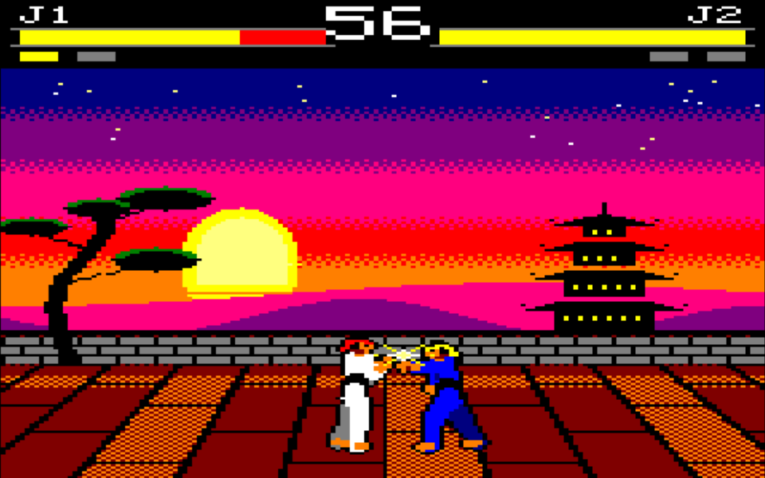
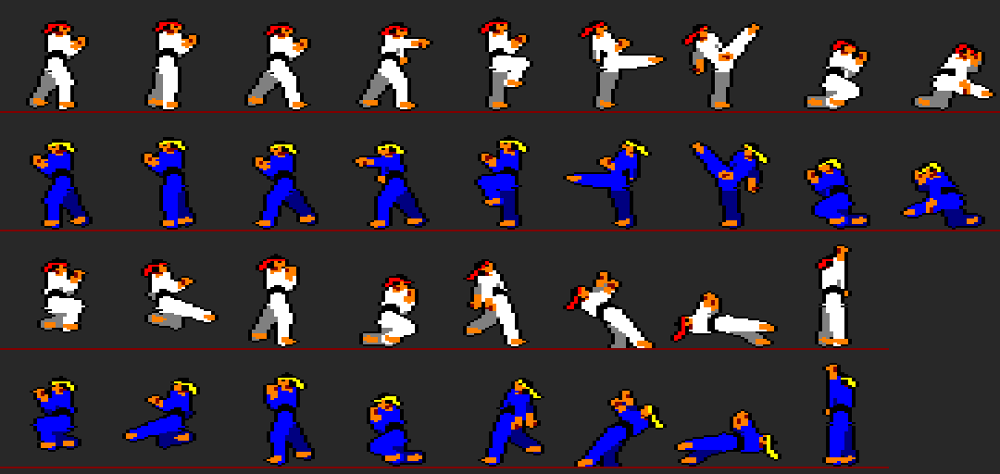
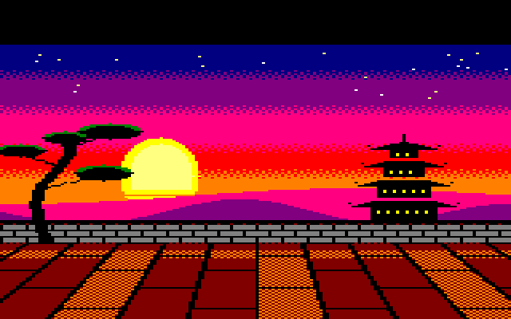

# KUNG-FU — La leyenda del dojo

Juego de lucha para Amstrad CPC en C (con algo de ensamblador) y CPCtelera, al estilo de *International Karate*, *Barbarian* o *Street Fighter*. Dos karatekas en un dojo al atardecer, para **1 jugador contra la CPU** o **2 jugadores**.



```bash
./cpc.sh run kung-fu        # desde la raíz del repositorio, en WSL
```

La petición original y el plan están en [PLAN.md](PLAN.md).

## Cómo se juega

| | Mover | Golpear |
|---|---|---|
| **Jugador 1** (blanco) | `W` `A` `S` `D` o joystick 1 | `ESPACIO` o fuego |
| **Jugador 2** (azul) | cursores o joystick 2 | `RETURN`, `ENTER` o `COPY`, o fuego |

En el título, `1` = contra la CPU, `2` = dos jugadores. `ESC` durante el combate vuelve al título.

Los golpes se hacen con **fuego + dirección**, así funcionan igual con teclado que con un joystick de un botón:

| Acción | Cómo | Altura | Daño |
|---|---|---|---|
| Puñetazo | fuego | alto | 6 |
| Patada | fuego + adelante | medio | 8 |
| Patada alta | fuego + arriba | alto | 10 |
| Barrido | fuego + abajo | bajo (derriba) | 7 |
| Patada voladora | fuego en el aire | medio | 10 |
| Salto | arriba (con adelante/atrás para saltar en esa dirección) | | |
| Cubrirse | atrás (retrocede despacio) | bloquea alto y medio | |
| Agacharse | abajo | esquiva los golpes altos | |
| Cubrirse agachado | abajo + atrás | bloquea medio y bajo | |

Es un piedra-papel-tijera: el barrido se esquiva saltando, el puñetazo y la patada alta pasan por encima del que está agachado, y la patada alta derriba al que viene saltando. Cada combate es al mejor de 3 asaltos de 60 segundos (si se acaba el tiempo gana quien tenga más energía). Contra la CPU, cada combate ganado sube el **nivel**: la CPU piensa más rápido y se defiende mejor.

## Ficheros

| Fichero | Qué es |
|---|---|
| `src/main.c` | Arranque y pantalla de título. |
| `src/juego.c` | Asaltos, marcador, mensajes y dibujado de cada imagen con doble búfer. |
| `src/luchador.c` | Estados de cada luchador, ataques, golpes, bloqueos. |
| `src/cpu.c` | El rival controlado por el ordenador. |
| `src/graficos.c` | Rutinas de sprites **en ensamblador**, fondo, texto, cambio de pantalla. |
| `src/sonido.c` | Motor de música y efectos por interrupción. |
| `src/kungfu.h` | Constantes y declaraciones comunes (mapa de memoria, estados...). |
| `gen/*.py` | **Generador** de todos los datos: sprites, fondo, fuente, música, tablas. |
| `src/datos/*` | Datos **generados** por `gen/genera.py`. No se editan a mano. |
| `img/luchadores.png`, `img/fondo.png` | Muestras que genera el generador para ver el resultado sin compilar. |
| `cfg/build_config.mk` | Configuración de CPCtelera, con dos cambios (ver más abajo). |

Para cambiar gráficos o música: edita `gen/*.py`, ejecuta `python3 gen/genera.py` (desde `kung-fu/`) y recompila.

## Cómo está hecho

### 1. Modo 0 y doble búfer

El juego usa el **modo 0**: 160x200 píxeles con 16 colores. Los píxeles son el doble de anchos que de altos y cada byte de memoria de vídeo guarda 2 píxeles.

Si dibujas y borras sprites en la misma pantalla que se está viendo, el haz del monitor a veces pilla el sprite a medio borrar: **parpadeo**. La solución es el **doble búfer**: hay dos pantallas, en `0xC000` y `0x8000`. Mientras se ve una, se dibuja en la otra, y luego se intercambian (`cpct_setVideoMemoryPage`). El cambio lo aplica el chip de vídeo (CRTC) al empezar el siguiente cuadro, así que nunca se ve nada a medias.

`graf_cambia()` además mantiene el ritmo: espera a que pasen 2 cuadros desde el cambio anterior, así el juego va siempre a **25 imágenes por segundo**.

### 2. El mapa de memoria

Dos pantallas son 32 KB: solo quedan 32 KB para todo lo demás. Por eso:

```
0x0100 - 0x7908   programa y datos (Z80CODELOC = 0x0100 en cfg/build_config.mk)
0x7C00 - 0x7CFF   tabla de espejo del jugador 2
0x7D00 - 0x7DFF   tabla de máscaras de transparencia
0x7E00 - 0x7FFF   pila (se mueve aquí con cpct_setStackLocation)
0x8000 - 0xBFFF   pantalla B
0xC000 - 0xFFFF   pantalla A
```

Consecuencias que conviene conocer:

- **La pila**: al arrancar está al final de la memoria (`0xBFFF`), justo dentro de la pantalla B. Lo primero que hace `main()` es moverla a `0x8000`.
- **La fuente de letras**: las funciones `cpct_drawString*` leen las letras de la ROM, y para eso activan la ROM baja, que **tapa** la memoria `0x0000-0x3FFF`... donde está nuestro programa. Se colgaría. Por eso hay una fuente propia de 5x7 (`gen/tablas.py`).
- **El nombre del proyecto**: `cpct_mkproject kung-fu` crea `PROJNAME := kung-fu`, pero en AMSDOS el guion da *Bad command* al hacer `RUN"`. Se cambió a `kungfu`. Como `cfg/` no se versiona y `cpc.sh` lo regeneraría con el nombre malo, `cfg/build_config.mk` se ha añadido a la lista blanca de `.gitignore`.

### 3. Los sprites: un esqueleto en Python

En vez de dibujar 17 posturas píxel a píxel, `gen/sprites.py` describe cada postura con **ángulos**, como un muñeco articulado:

```python
('patada', dict(tronco=-22, pd=(94, 0), pt=(-8, 8), pie_d='punta', bd=(45, 85), bt=(-20, 70))),
#               inclinación  pierna delantera: muslo 94º, rodilla recta
```

El programa calcula dónde cae cada articulación (cadera → rodilla → tobillo, hombro → codo → mano) y pinta el cuerpo con **cápsulas** (segmentos gruesos): pantalón y manga del kimono, antebrazos y pies de piel, cinturón negro, cabeza con pelo, cinta roja y ojo. Se pinta de atrás adelante (brazo y pierna de atrás en gris, de delante en blanco) y al final se añade un **contorno negro** para que se distingan del fondo. Ajustar una postura es cambiar un número.



**El jugador 2 no tiene sprites propios**: usa los mismos dados la vuelta y con otros colores. Al dibujarlo, cada byte pasa por una tabla de 256 entradas (`g_tabla_espejo`) que intercambia sus dos píxeles y cambia blanco→azul, gris→azul oscuro y la cinta roja→amarilla. Así se ahorra la mitad de la memoria de sprites.

### 4. Transparencia con tabla de máscaras

El color 0 de los sprites es transparente. Para pintar un byte del sprite sobre el fondo:

```
pantalla = (fondo AND mascara[byte]) OR byte
```

`mascara[byte]` tiene a 1 los bits de los píxeles transparentes de ese byte (conserva el fondo ahí) y a 0 los demás. La tabla está en una dirección múltiplo de 256 (`0x7D00`) para que el ensamblador la consulte cargando el byte en el registro bajo: `ld c,a / ld a,(bc)` con `b = 0x7D`.

### 5. Borrar sin parpadeo: el fondo guardado en crudo

Para mover un sprite hay que borrarlo primero, es decir, volver a poner el fondo que había debajo. El fondo (`gen/fondo.py`) se guarda en dos trozos:

- Líneas 100-199 (la **franja de lucha**, donde se mueven los luchadores): 8000 bytes **sin comprimir** en `g_franja`. Borrar un sprite es copiar bytes de ahí a la pantalla con `LDIR`, lo más rápido que hay.
- Líneas 28-99 (el cielo): comprimidas con **RLE** (1391 bytes en vez de 5760). Solo se descomprimen al empezar el asalto y para borrar los mensajes grandes.



### 6. La optimización: cómo se midió y cómo se arregló

La primera versión iba al ~70 % de velocidad. Para ver dónde se iba el tiempo se usó el truco clásico de los programadores de CPC: **cambiar el color del borde** al empezar cada parte del bucle. El haz del monitor dibuja el borde con el color que haya en cada momento, así que en pantalla aparecen franjas cuya altura es el tiempo que tarda cada parte. (Está en `juego.c`: descomenta `#define PERFIL` para verlo.)

Resultado: dibujar cada luchador tardaba 10-15 ms porque **cada byte** pasaba por la tabla de máscaras (~25 microsegundos por byte). Arreglos:

1. **Sprites por tramos de tres tipos.** El generador clasifica los bytes de cada fila: *opacos* (los dos píxeles con color), *con transparencia* y *vacíos*. Los opacos, que son la mayoría, se copian con `LDIR` (6 µs/byte); los vacíos ni se tocan; solo los bordes usan la máscara. Formato de cada fila: `inicio, tramos..., 0`, con cabeceras `0x80+n` (n opacos), `0x40+n` (n vacíos) y `n` (n con transparencia).
2. **Rutinas en ensamblador** (`dibuja_spr` y `restaura_spr` en `graficos.c`) con los punteros en registros. Usan un truco de **código automodificable**: el final de cada tramo se escribe dentro de la propia instrucción `cp #0`.
3. **No redibujar lo que no cambia**: cada pantalla recuerda qué tiene dibujado. Si un luchador está quieto y nada le toca, no se borra ni se repinta.

Ahora una imagen con los dos luchadores en movimiento cabe de sobra en los 2 cuadros (40 ms).

### 7. Lógica de los luchadores

Cada luchador es una **máquina de estados** (`luchador.c`): normal, agachado, salto, ataque, golpeado, caído, K.O., victoria. En cada tick (1/25 s) se leen los controles y se decide qué hacer.

Los ataques están en una tabla con sus fases:

```c
//  preparación     golpe            recup  altura     daño
{ P_PREPARA,  3,  P_PATADA,    4,   3,  ALT_MEDIO,  8 },   // A_PATADA
```

Primero la postura de preparación (rodilla arriba) durante 3 ticks, luego 4 ticks en los que la patada **hace daño**, y 3 de recuperación. El alcance sale del propio sprite: el generador calcula hasta dónde llega por delante cada postura (`frente`).

Un detalle de justicia: los golpes de los dos se **evalúan antes de aplicarse**. Si no, cuando los dos golpean a la vez el jugador 1 siempre ganaría por ser el primero en comprobarse.

### 8. La CPU

`cpu.c` no hace trampas: decide qué "teclas" pulsar (los mismos bits que el teclado o el joystick) y la lógica del luchador hace el resto. Reglas:

- Si el rival empieza un golpe y estamos a su alcance: con cierta probabilidad se defiende (salta los barridos, se agacha ante los golpes altos, se cubre ante los medios).
- Si el rival viene con una patada voladora: patada alta para recibirle.
- Lejos: se acerca andando o saltando (y a veces lanza la patada voladora).
- Cerca: ataca al azar y espera un rato antes de volver a decidir.

El **nivel** sube las probabilidades de defenderse y acorta la espera entre decisiones.

### 9. Sonido: el AY-3-8912 desde la interrupción

El chip de sonido tiene 3 canales: la música usa el A (melodía) y el B (bajo y percusión con ruido), y el canal C queda para los **efectos** (golpe, bloqueo, salto, K.O., gong...).

- El motor (`sonido.c`) se ejecuta **en la interrupción** del CPC, que salta 300 veces por segundo; la que coincide con el retrazado vertical (VSYNC) marca el cuadro, y en ella se actualiza el sonido. Así el ritmo de la música no depende de lo que tarde el juego en dibujar.
- El programa principal no toca el chip: solo pide cosas cambiando una variable (`musica()`, `efecto()`), y la interrupción las recoge. Así nunca se pisan.
- El AY no está conectado directamente al procesador: se le habla a través del **PPI 8255** (puerto A = dato, puerto C = orden). Eso hace `psg_vuelca()` en ensamblador.
- La música se escribe como texto en `gen/musica.py` (`"E5:4 D5:2 E5:2 G5:4"`), en escala **pentatónica de mi menor**, que suena "oriental". El generador la convierte a parejas nota/duración y calcula el periodo de cada nota: `periodo = 1000000 / (16 * frecuencia)`.

### 10. Generar en vez de dibujar

Todo el contenido (sprites, fondo, fuente, música, paleta, tablas) sale de `gen/genera.py`. Ventajas: se puede cambiar cualquier cosa tocando un número, y el generador comprueba cosas (por ejemplo, que los dos canales de cada canción duren lo mismo). Los `.c` generados sí se versionan, para que el proyecto compile sin necesidad de ejecutar Python.

## Lecciones aprendidas

- **Medir antes de optimizar**: el borde de colores mostró en un minuto que el problema era el dibujado de sprites y no la lógica.
- Con el código en memoria baja, **nada que active la ROM baja** (como la fuente de la ROM).
- En CPCtelera **las variables globales no se inicializan**: todo se rellena en tiempo de ejecución, o se declara `const`.
- **Nombres AMSDOS**: solo letras y números.

## Ideas para seguir

- Más rivales con otros colores (basta otra tabla de espejo).
- Barras de energía que bajan poco a poco, sacudida de pantalla en los golpes fuertes.
- Más golpes: codazo, patada giratoria, proyecciones.
- Una fase de "bonus" entre combates, como las pelotas que hay que desviar en *IK+*.
